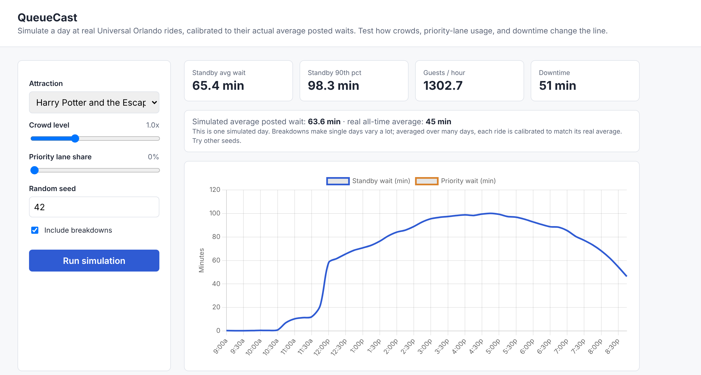

# QueueCast


**[▶ Live demo](https://queuecast-sigma.vercel.app)** · [API docs](https://queuecast-sigma.vercel.app/docs)



**A discrete-event simulator that forecasts theme park wait times for 41 real Universal Orlando rides, calibrated against their actual average posted waits, and tests operating decisions before they happen on a real ride.**

I work in a theme park kitchen, so I watch crowds rise and fall all day. QueueCast models one operating day at a ride and answers questions like these:

- What will the posted standby wait be at 3 PM on a busy day?
- If 40% of guests use a priority lane, how much longer does standby get?
- How much does a 20-minute breakdown at peak hours cost in wait time?

It includes a Python simulation engine, a calibration step fit to real data, live posted waits for Universal Orlando, a SQLite results store, a REST API, a CLI, a browser dashboard, and a CI pipeline that tests every push.

## Quick start

```bash
python -m venv .venv
source .venv/bin/activate        # Windows: .venv\Scripts\Activate.ps1
pip install -e ".[dev]"

queuecast list                                           # all 41 rides with real average waits
queuecast run revenge-of-the-mummy --crowd 1.2           # simulate a busy day
queuecast compare revenge-of-the-mummy --shares 0 0.2 0.4 0.6
queuecast calibrate                                      # refit demand to real data (~5 min)

uvicorn queuecast.api:app --reload                       # dashboard at http://127.0.0.1:8000
pytest --cov=queuecast                                   # 71 tests
```

## Real data and calibration

**Rides.** The 41 rides across Universal Studios Florida, Islands of Adventure, and Epic Universe come from [Queue-Times.com](https://queue-times.com/), along with each ride's all-time average posted wait.

**Capacity.** Universal doesn't publish seats per vehicle or dispatch intervals, so each ride's capacity is an **estimate** based on public descriptions of its ride system.

**Demand is calibrated.** How many guests show up is the one thing nobody publishes, so QueueCast solves for it. `queuecast calibrate` uses bisection to find the arrival rate at which the ride's simulated average posted wait, averaged over 20 simulated days, matches the real one.

**How well it fits.** I checked the result on 40 simulated days the calibration never saw:

| Measure | Result |
| --- | --- |
| Mean absolute error | 2.8 min |
| Rides within 5 min of their real average | 41 of 41 |

**A lesson from getting this to work.** My first attempt looked perfect, but only by luck. Every source of randomness shared one random-number stream, so a tiny change in demand reshuffled the whole day and the search could never converge reliably. I fixed it with *common random numbers* (separate streams for arrivals, lanes, and breakdowns) and *time-rescaled* arrivals (raising demand compresses arrival times smoothly instead of redrawing them). See [ADR 0003](docs/decisions/0003-common-random-numbers.md).

The full method and its limits are in [docs/DATA.md](docs/DATA.md).

## Live wait times

The dashboard shows current posted waits for all three parks, refreshed at most every 5 minutes. For the selected ride it also compares three numbers:
- the simulated average posted wait,
- the real all-time average,
- what's posted right now.

Live data is [Powered by Queue-Times.com](https://queue-times.com/).

## Example: the cost of a priority lane

Same simulated day at Revenge of the Mummy (seed 42), changing only the share of guests who use a priority lane:

```
Revenge of the Mummy: priority-lane what-if (seed 42)
 PRIORITY  STANDBY AVG  STANDBY P90  PRIORITY AVG
       0%         53.8         81.4           0.0
      20%         66.4        100.1           1.9
      40%         86.5        131.2           4.0
      60%         99.6        170.2          23.1
```

When 40% of guests use the priority lane, the average standby guest waits 61% longer. At 60%, the priority lane itself starts to back up.

These are **per-guest** averages, so they run higher than the ride's posted average of 31 minutes. Most guests arrive during the busy afternoon, when the line is longest.

## How it works

```
 arrivals (Poisson, varies by hour)
        │
        ▼
 ┌──────────────┐   min-heap of timed events   ┌──────────────┐
 │  Simulator   │ ───────────────────────────► │  Guest log   │
 │  ARRIVAL     │   ARRIVAL / DISPATCH /       │  (arrive,    │
 │  DISPATCH    │   BREAKDOWN / REPAIR         │   board,     │
 │  BREAKDOWN   │                              │   lane)      │
 └──────────────┘                              └──────┬───────┘
                                                      │ metrics.py
                                                      ▼
                         ┌──────────┐   ┌──────────────────────────┐
     CLI  ◄──────────────│ summary  │──►│ SQLite: runs + 15-min    │
     REST API / dashboard│ + waits  │   │ interval metrics         │
                         └──────────┘   └──────────────────────────┘
```

- **Event engine:** a priority queue (`heapq`) always processes the next event in time order, which is the standard discrete-event simulation pattern. Each event costs O(log n).
- **Arrivals:** a non-homogeneous Poisson process generated by time-rescaling, so demand follows a realistic daily curve (morning rush, midday peak, dinner dip).
- **Boarding:** each vehicle gives up to `priority_seat_ratio` of its seats to the priority lane and fills the rest from standby. Unused seats go back to whichever line still has guests, so no seat leaves empty while someone is waiting.
- **Breakdowns:** random failures and repairs, controlled by each ride's mean time between failures and mean time to repair.
- **Reproducibility:** every run is seeded, and each source of randomness has its own stream, so a scenario comparison changes only the variable being tested.

See [docs/ARCHITECTURE.md](docs/ARCHITECTURE.md) for design details and [docs/decisions](docs/decisions) for the reasoning behind key choices.

## API

| Method | Path | Purpose |
| --- | --- | --- |
| GET | `/attractions` | Rides with capacity, park, and real average wait |
| POST | `/simulations` | Run and save one simulated day |
| POST | `/simulations/compare` | Same day at several priority-lane shares |
| GET | `/simulations` | Recent runs (filter by `attraction_id`) |
| GET | `/simulations/{id}` | Run summary plus its peak wait window |
| GET | `/simulations/{id}/wait-times` | Standby and priority wait per 15 minutes |
| GET | `/reports/attractions` | SQL aggregate across all saved runs |
| GET | `/live/parks` | Parks with live wait times |
| GET | `/live/parks/{id}` | Current posted waits for one park |

Interactive docs are at `/docs` while the server is running.

## Testing and CI

GitHub Actions runs `ruff` linting, the full `pytest` suite with a coverage gate of 85%, and a CLI smoke test on Python 3.11, 3.12, and 3.13 for every push and pull request.

The tests check behavior as well as code paths:
- A vehicle is never overfilled.
- Standby boards first-in, first-out.
- Nobody boards before arriving.
- Throughput never exceeds theoretical capacity.
- Calibration hits its targets.
- The shipped rides still reproduce their real average waits.

Live-data tests use saved sample responses, so CI never depends on an outside API.

## Project structure

```
queuecast/
  models.py      Attraction, Scenario, result dataclasses, with validation
  simulator.py   discrete-event engine
  metrics.py     summaries, percentiles, 15-minute posted waits
  calibrate.py   fits each ride's demand to its real average wait
  live.py        live posted waits from Queue-Times.com (cached)
  db.py          SQLite schema and queries
  api.py         FastAPI app
  cli.py         command line interface
  static/        dashboard (HTML + Chart.js)
  data/          41 Universal Orlando rides (estimated capacity, calibrated demand)
tests/           pytest suite
docs/            architecture notes, data sources, decision records
```

## Notes

Not affiliated with Universal or Queue-Times.com. Ride capacities are estimates, and posted waits come from the parks, which can differ from actual waits.

## Roadmap

- [x] Calibrate against public historical wait-time data
- [ ] Guests who leave when the line is too long
- [ ] Return-time windows for the priority lane (guests book a time instead of arriving at once)
- [ ] Single-rider line
- [ ] Multi-attraction park model where guests move between rides
- [ ] Docker image
